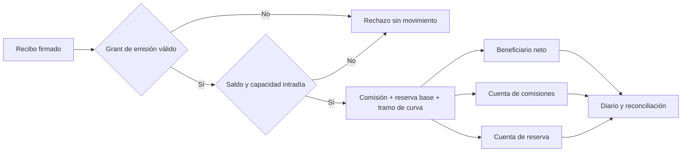

# Reservas intradía

## Alcance

La reserva intradía se asigna durante la liquidación de recibos firmados. La política del grant
establece el límite por recibo, la capacidad diaria, las cuentas de comisión y reserva, la tasa base
y la pendiente de la curva. El recibo conserva un compromiso criptográfico de esa política; una
rotación posterior no cambia sus destinatarios ni sus parámetros económicos.

El motor registra el bruto aceptado por cuenta y epoch en el diario. Un rechazo no consume
capacidad. La ejecución de un lote es secuencial y cada recibo conserva atomicidad propia.

## Parámetros y unidades

| Símbolo | Campo             | Unidad                               |
| ------- | ----------------- | ------------------------------------ |
| `G`     | `grossAmount`     | unidad mínima del activo             |
| `D`     | `dailyLimit`      | unidad mínima del activo por epoch   |
| `f`     | `operatorFeeBps`  | puntos básicos                       |
| `r`     | `reserveBps`      | puntos básicos                       |
| `c`     | `reserveCurveBps` | puntos básicos                       |
| `U`     | `settledGross`    | unidad mínima del activo en el epoch |

La configuración exige `f + r + c ≤ 10 000`, `G ≤ receiptLimit` y `U + G ≤ D`. Los importes
resultantes se calculan en enteros. El redondeo de cada componente es `floor`; el residuo queda en
el tramo neto después de restar comisión y reserva.

En la política Atlas, `f = 40`, `r = 25`, `c = 1 600` y `D = 1 000 000`. Un recibo de `25 000`
unidades genera una comisión de `100`, una reserva base de `62` y un componente de curva de `100`.
El neto acreditado es `24 738`. Esta distribución se observa en `scenario receipts --json`.

## Operación de un ciclo

1. El operador emite recibos con nonce único y ventana temporal acotada.
2. Tesorería verifica el manifiesto y la capacidad disponible.
3. El procesador ejecuta los recibos en orden; el diario conserva el bruto de cada aceptación.
4. Reconciliación compara débito, tres créditos y suministro interno.
5. Si corresponde un pago externo, el beneficiario retira únicamente su saldo neto contabilizado.

`scenario reserves --json` muestra un ciclo de nueve recibos para el mismo beneficiario, seguido de
su pago externo. El resultado separa decisiones de liquidación, retirada, saldos finales y digest de
reconciliación. En un despliegue integrado, el adaptador del activo debe conservar los
identificadores de transacción externa junto al `receiptId` y al `stateDigest`.

## Observabilidad

Revise por epoch el bruto asentado, el consumo de capacidad, los tres tramos de distribución y las
retiradas. Una alerta operativa debe comparar la disponibilidad antes de emitir un nuevo recibo con
el último diario confirmado. Los ensayos de estrés y concentración de
[riesgo de liquidez](./liquidity-risk.md) son complementarios; no sustituyen la liquidación.
